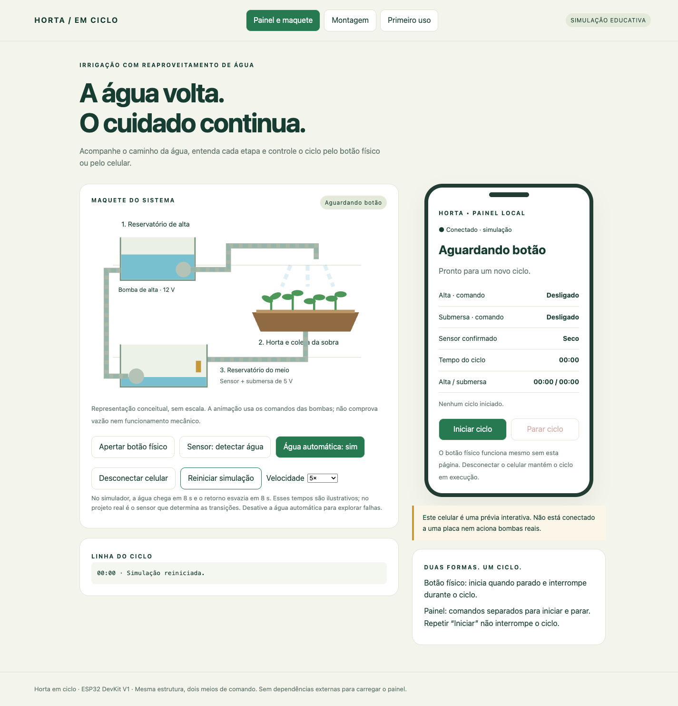

# Horta em ciclo · ESP32 DevKit V1

Sistema de irrigação com reaproveitamento de água, botão físico e painel web local hospedado no próprio ESP32. Inclui manual de montagem, maquete animada, celular simulado e exploração interativa das ligações.

Adaptação do projeto Arduino UNO fornecido, preservando os componentes e a sequência hidráulica. O botão funciona sem celular, internet ou interface aberta.



## Comece por aqui

- **Ver o projeto sem placa:** abra [site/index.html](site/index.html) no navegador. Funciona offline e não aciona hardware real.
- **Montar:** abra a aba **Montagem** no site. Explore os pinos da placa e confira as ligações de controle e potência.
- **Gravar:** abra [HortaPortal/HortaPortal.ino](HortaPortal/HortaPortal.ino) na Arduino IDE, mantendo [Portal.h](HortaPortal/Portal.h) na mesma pasta.
- **Conferir o que foi testado:** leia [VALIDACAO.md](VALIDACAO.md). Não há validação em placa física nem compilação com o núcleo ESP32 nesta entrega.

## Componentes mantidos

- ESP32 DevKit V1 com ESP32-WROOM-32, substituindo o Arduino UNO.
- Botão físico.
- Sensor de chuva/água com módulo LM393, saída digital DO.
- Módulo relé de dois canais com alimentação de bobina de 5 V; compatibilidade das entradas com 3,3 V deve ser confirmada.
- Bomba de alta de 12 V e sua fonte.
- Bomba submersa de 5 V e sua fonte.
- Fiação e estrutura hidráulica existentes.

Não exige Bluetooth, roteador, aplicativo, LED externo nem novos sensores. O exemplo ilustrado da placa é de 30 pinos; confira a serigrafia na sua versão.

## Ciclo de funcionamento

1. Botão físico ou **Iniciar ciclo** liga a bomba de alta.
2. Sensor confirma água no reservatório do meio após 1 segundo estável.
3. Aguarda 2 segundos e desliga a alta.
4. Aguarda 5 segundos e liga a submersa para devolver a água ao reservatório superior.
5. Sensor confirma seco após 1 segundo estável, desliga a submersa e encerra o ciclo.

Cada bomba tem limite de 10 minutos; o da alta inclui a espera anterior ao desligamento. O botão físico durante o ciclo ou **Parar ciclo** interrompe as duas saídas. Repetir **Iniciar** não reinicia nem interrompe um ciclo ativo. Reiniciar a placa deixa o programa parado; os estados elétricos dos relés durante boot precisam ser garantidos pelo circuito externo.

Fechar o painel ou desconectar o celular mantém o ciclo em andamento. Ao reconectar, o painel consulta o estado atual. Os indicadores mostram os **comandos** das bombas, sem confirmar vazão ou funcionamento mecânico.

## Pinos e montagem

Use o nome impresso ao lado do terminal, não a posição contada na placa.

| Função | Impressão comum | Número no código |
| --- | --- | --- |
| Botão para GND | D18 / 18 | 18 |
| Saída DO do sensor | D19 / 19 | 19 |
| IN1 do relé da alta | D25 / 25 | 25 |
| IN2 do relé da submersa | D26 / 26 | 26 |
| Referência dos sinais | GND | GND |

O tutorial interativo usa cartões no mobile e abre as explicações dos pinos em modal.

**Antes de conectar:** GPIOs do ESP32 não toleram 5 V. Confirme DO até 3,3 V e entradas de relé compatíveis. Uma bobina de 5 V não garante entrada lógica de 3,3 V. A ligação VCC/JD-VCC e a interface de entrada dependem do módulo real. Não alimente bombas nem bobinas pelos GPIOs ou pelo 3V3. Consulte os circuitos COM/NO no site; faça o primeiro teste com bombas desconectadas.

## Instalar e gravar

1. Instale a Arduino IDE.
2. Nas Preferências, adicione às URLs adicionais do Gerenciador de Placas:
   ```text
   https://espressif.github.io/arduino-esp32/package_esp32_index.json
   ```
3. No Gerenciador de Placas, instale **esp32 by Espressif Systems**, versão **3.3.12**, correspondente aos fontes incluídos. Essa escolha fixa a dependência; não significa que o firmware já tenha sido compilado nessa versão.
4. Selecione **DOIT ESP32 DEVKIT V1**, se disponível, ou **ESP32 Dev Module** para a placa WROOM-32, e a porta USB.
5. Abra `HortaPortal/HortaPortal.ino`; mantenha `Portal.h` junto dele.
6. Troque `AP_PASSWORD` antes do uso. Confira polaridades e tempos no início do programa.
7. Compile e grave com as bombas desconectadas. Se necessário, mantenha BOOT pressionado enquanto a IDE tenta conectar e solte ao iniciar a transferência.
8. Monitor Serial: **115200 baud**.
9. Execute o checklist da aba **Primeiro uso** antes de conectar as bombas.

### Bibliotecas incluídas

O firmware usa **WiFi**, **WebServer** e **DNSServer**, que já fazem parte do núcleo Arduino-ESP32. Não exige bibliotecas externas adicionais.

A pasta [bibliotecas](bibliotecas/LEIA-ME.md) contém cópias oficiais da tag **3.3.12**, com dependências de apoio **Network, AsyncUDP, FS e Hash**, licença, origem e hashes SHA-256. Não copie essas pastas para o sketch nem instale versões duplicadas: use as que acompanham o pacote da placa. Os fontes incluídos não substituem o compilador, SDK e restante do núcleo; não são um instalador offline completo.

## Conectar o celular

- Rede inicial: **Horta**.
- Senha inicial: **Horta2026** — troque no firmware antes do uso.
- Endereço: **http://192.168.4.1**.

Conecte à rede e permaneça nela quando o celular informar “sem internet”. O DNS do portal tenta conduzir a abertura automática. Se não abrir, digite o endereço HTTP no navegador. O comportamento automático precisa ser testado em iPhone e Android reais e não intercepta HTTPS.

O painel usa consultas periódicas de estado e comandos separados para iniciar e parar. A senha da rede controla quem pode acessar o painel; não há contas individuais. O programa não depende da presença do celular.

## Simulador e manual

No computador, a maquete aparece ao lado do celular. No mobile, o celular aparece primeiro e iniciar o ciclo abre a maquete em modal.

- Água automática para demonstrar o ciclo, ou sensor manual para explorar situações.
- Velocidade de 1×, 5× ou 20×, selecionada acima da maquete.
- Botão físico simulado para iniciar/interromper.
- Desconectar e reconectar o celular para observar continuidade do ciclo e recuperação dos dados.
- Pinos destacados do ESP32 mostram fio, destino, cuidados e exemplo educativo; no mobile, em modal.

A chegada de água e o esvaziamento automáticos de 8 segundos são didáticos, exclusivos do simulador. O firmware usa o sensor real. Exemplos dos pinos nunca enviam comandos à placa.

## Estrutura do repositório

```text
.
├── README.md
├── index.html                    # Entrada para o site, inclusive GitHub Pages
├── site/index.html               # Manual e simulador, sem dependências externas
├── HortaPortal/
│   ├── HortaPortal.ino            # Controle, Wi-Fi, HTTP e DNS
│   └── Portal.h                  # Site embutido em modo de placa
├── scripts/gerar_portal.py        # Sincroniza o site com Portal.h
├── bibliotecas/                  # Fontes oficiais, licenças, origem e hashes
├── referencia/projeto-original-uno/ # Arquivos originais preservados
├── COMECE-AQUI.md
├── VALIDACAO.md
├── LICENSE
└── *.png                         # Prévias visuais
```

### Atualizar o site embutido

Edite `site/index.html` e execute, a partir da raiz do repositório:

```sh
python3 scripts/gerar_portal.py
```

O script troca somente o marcador de modo para gerar `HortaPortal/Portal.h`. Depois recompile e grave a placa. A página do computador permanece no modo de simulação.

### Colocar no GitHub

Extraia o ZIP e envie **o conteúdo da pasta HortaPortal** para a raiz do seu repositório, incluindo os arquivos ocultos, sem enviar o próprio ZIP. O README será mostrado automaticamente.

Para disponibilizar o manual e simulador no **GitHub Pages**, selecione publicação a partir da branch desejada e da pasta raiz. A página inicial encaminha para `site/`. O site publicado é uma demonstração; o controle real continua na rede local do ESP32. Nenhuma publicação no GitHub foi feita por esta entrega.

## Limites e evidências

[VALIDACAO.md](VALIDACAO.md) separa testes da lógica, testes de navegador e o que ainda precisa de bancada. O sistema não mede litros, vazão, umidade do solo nem o nível superior. Limites de tempo não detectam imediatamente falta de água ou transbordamento. O botão é parada por software; a aplicação não oferece garantia de tempo real.

A inclusão das bibliotecas não altera o status da validação: ainda é necessário compilar, gravar e testar o conjunto real.

## Origem e licenças

Baseado no arquivo `IrrigacaoHorta.ino` do projeto `Irriga-o-da-Horta-main.zip` fornecido pelo usuário. Os originais estão preservados em `referencia/projeto-original-uno/`.

O projeto original inclui a licença [Apache 2.0](LICENSE). As bibliotecas da Espressif mantêm suas próprias licenças e avisos, preservados na pasta `bibliotecas`; consulte o `LICENSE.md` distribuído com os fontes e os cabeçalhos de cada arquivo. Ilustrações desta versão são diagramas educativos, sem escala.

Fontes oficiais: [Arduino-ESP32 3.3.12](https://github.com/espressif/arduino-esp32/releases/tag/3.3.12), [instalação](https://docs.espressif.com/projects/arduino-esp32/en/latest/installing.html) e [Wi-Fi](https://docs.espressif.com/projects/arduino-esp32/en/latest/api/wifi.html).
